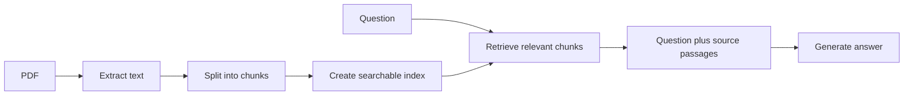

# Day 1 — NLP, LLMs, and RAG

Examples use Python 3 and only its standard library. Each exercise is a small learning model: real language models use larger vocabularies, learned parameters, and more careful algorithms.

## 1. NLP, preprocessing, and tokenization

**Natural language processing (NLP)** helps computers work with human language. **Preprocessing** makes text consistent; **tokenization** splits text into pieces a model can process. Real tokenizers can split words into subwords, while this first exercise uses simple word tokens.

### Exercise: clean text, tokenize it, and count words

Steps:

1. Lowercase the text and remove punctuation.
2. Split it into word tokens.
3. Print the cleaned text, tokens, and number of tokens.
4. Count repeated words.

```python
import string
from collections import Counter

text = "NLP helps computers understand text. Text can be cleaned!"
cleaned = text.lower().translate(str.maketrans("", "", string.punctuation))
tokens = cleaned.split()
counts = Counter(tokens)

print("Cleaned:", cleaned)
print("Tokens:", tokens)
print("Token count:", len(tokens))
print("Count of 'text':", counts["text"])
```

Expected output:

```text
Cleaned: nlp helps computers understand text text can be cleaned
Tokens: ['nlp', 'helps', 'computers', 'understand', 'text', 'text', 'can', 'be', 'cleaned']
Token count: 9
Count of 'text': 2
```

Removing punctuation is appropriate for this simple count, but preprocessing must fit the task. `can't` and `cant`, for example, may not mean the same thing.

## 2. Bag of Words and TF-IDF

**Bag of Words (BoW)** represents each document by word counts and ignores word order. **TF-IDF** means **Term Frequency–Inverse Document Frequency**. It gives a word a larger weight when it appears often in one document and in few documents overall. Both are useful baselines, but neither understands synonyms.

For a word *w* in document *d*, this lesson uses:

- **Term frequency (TF):** `count(w in d)`
- **Document frequency (DF):** number of documents that contain *w*
- **Inverse document frequency (IDF):** `log((1 + N) / (1 + DF)) + 1`, where `N` is the number of documents. Smoothing keeps the calculation defined even when a word is unseen.
- **TF-IDF:** `TF × IDF`

Some tools normalize TF or the final vector differently. This simple count-based version is chosen so the arithmetic is easy to follow.

### Exercise: compare BoW counts and TF-IDF weights

Steps:

1. Make a vocabulary from all three documents.
2. Count each vocabulary word in each document (BoW).
3. Calculate IDF for each word with `log((1 + N) / (1 + document_count)) + 1`.
4. Multiply each word count by its IDF and print the result for Document 1.

```python
import math
from collections import Counter

documents = [
    "cat sat mat",
    "cat ate fish",
    "dog sat log",
]
tokenized = [doc.split() for doc in documents]
vocabulary = sorted(set(word for doc in tokenized for word in doc))

document_counts = {
    word: sum(word in doc for doc in tokenized)
    for word in vocabulary
}
idf = {
    word: math.log((1 + len(documents)) / (1 + document_counts[word])) + 1
    for word in vocabulary
}

bow = Counter(tokenized[0])
tfidf = {word: round(bow[word] * idf[word], 2) for word in vocabulary}
print("Vocabulary:", vocabulary)
print("Document 1 BoW:", dict(sorted(bow.items())))
print("Document 1 TF-IDF:", tfidf)
```

Expected output:

```text
Vocabulary: ['ate', 'cat', 'dog', 'fish', 'log', 'mat', 'sat']
Document 1 BoW: {'cat': 1, 'mat': 1, 'sat': 1}
Document 1 TF-IDF: {'ate': 0.0, 'cat': 1.29, 'dog': 0.0, 'fish': 0.0, 'log': 0.0, 'mat': 1.69, 'sat': 1.29}
```

`mat` is more distinctive here because it occurs in fewer documents. BoW and TF-IDF still treat word order as irrelevant.

## 3. Embeddings and semantic similarity

An **embedding** is a vector of numbers representing text. A trained embedding model aims to put texts with related meanings near each other. **Cosine similarity** compares vector direction; larger values mean more similar directions. The vectors below are hand-made so we can practice the calculation. They are not real language embeddings.

### Exercise: compute cosine similarity

Steps:

1. Calculate the dot product of two vectors.
2. Calculate each vector’s length.
3. Divide the dot product by both lengths.
4. Compare identical and different directions.

```python
import math

def cosine(a, b):
    dot = sum(x * y for x, y in zip(a, b))
    length_a = math.sqrt(sum(x * x for x in a))
    length_b = math.sqrt(sum(y * y for y in b))
    return round(dot / (length_a * length_b), 2)

# Imagine these vectors were returned by an embedding model.
password_reset = [1, 0.8, 0]
forgot_login = [0.9, 0.7, 0.1]
weather_question = [0, 0, 1]

print("password vs login:", cosine(password_reset, forgot_login))
print("password vs weather:", cosine(password_reset, weather_question))
```

Expected output:

```text
password vs login: 1.0
password vs weather: 0.0
```

Formula: `cosine(a, b) = (a · b) / (||a|| × ||b||)`, where `a · b` is the dot product and `||a||` is a vector length. The result is usually between −1 and 1. A high similarity helps retrieval, but it does not prove that the passage answers the question.

## 4. Attention and Transformers

A **Transformer** processes tokens using **attention**. Attention gives each token a weighted combination of information from tokens around it. The weights depend on the input and are learned by the model. A weighted combination is `context = Σ(weightᵢ × valueᵢ)`. The weights usually add up to 1. This simplified exercise manually sets weights to show the weighted-combination step; it is not a complete Transformer.

### Exercise: combine token information with attention weights

Suppose the sentence is “Birds fly because they have wings.” The token `they` should use information from `Birds` and `wings`.

Steps:

1. Give each token a small made-up numeric representation.
2. Set larger attention weights for the relevant words.
3. Multiply each representation by its weight and add them.
4. Print the contextual representation for `they`.

```python
tokens = ["Birds", "fly", "because", "they", "have", "wings"]
values = {
    "Birds": [1.0, 0.0],
    "fly": [0.0, 1.0],
    "because": [0.0, 0.0],
    "they": [0.0, 0.0],
    "have": [0.0, 0.0],
    "wings": [0.8, 0.2],
}
weights_for_they = [0.45, 0.05, 0.05, 0.10, 0.05, 0.30]
context = [
    sum(weights_for_they[i] * values[token][axis] for i, token in enumerate(tokens))
    for axis in range(2)
]
print("Weights sum to:", round(sum(weights_for_they), 2))
print("Context for 'they':", [round(value, 2) for value in context])
```

Expected output:

```text
Weights sum to: 1.0
Context for 'they': [0.69, 0.11]
```

The example demonstrates weighted context only. A real Transformer calculates attention weights from learned query, key, and value vectors across many layers.

## 5. LLMs, BERT, and GPT-style models

An **LLM** is a large language model. A generative model such as a GPT-style model predicts a next token, appends it, then predicts again. In probability notation, it chooses a likely next token using `P(next token | previous tokens)`. **BERT** is commonly used to represent or classify text. Both are pretrained models, meaning they learned patterns from data before use. They can still be wrong or out of date.

### Exercise: generate a short sequence with a toy next-token model

Steps:

1. Create a tiny dictionary of next-token choices.
2. Start with a prompt.
3. Add the predicted token twice.
4. Print each generation step.

```python
next_token = {
    "AI": "can",
    "AI can": "help",
    "AI can help": "students",
}
tokens = ["AI"]

for _ in range(3):
    context = " ".join(tokens)
    predicted = next_token[context]
    tokens.append(predicted)
    print("Predicted:", predicted, "| Text:", " ".join(tokens))
```

Expected output:

```text
Predicted: can | Text: AI can
Predicted: help | Text: AI can help
Predicted: students | Text: AI can help students
```

This illustrates next-token generation. A real LLM chooses from a large vocabulary using learned probabilities and the full context.

## 6. RAG: chunk, retrieve, and prepare context

**Retrieval-augmented generation (RAG)** searches source documents before asking an LLM to answer. A basic pipeline extracts text, splits it into **chunks**, retrieves relevant chunks, places them in the prompt (**context injection**), then generates an answer. Embeddings often improve retrieval beyond exact keyword matching.



### Exercise: build a tiny keyword RAG pipeline

Steps:

1. Split a short document into chunks of three words with one word of overlap.
2. Compare question words with each chunk (this is a simple stand-in for semantic retrieval).
3. Select the chunk with the most matching words.
4. Print the two best chunks. These are the passages you would send to the LLM.

```python
document = "RAG retrieves useful passages. An LLM reads those passages and answers questions."
words = document.lower().replace(".", "").split()
chunk_size = 3
overlap = 1
chunks = []
start = 0
while start < len(words):
    chunks.append(words[start:start + chunk_size])
    start += chunk_size - overlap

question = "What does the LLM read?"
question_words = set(question.lower().replace("?", "").split()) - {"what", "does", "the"}
ranked = sorted(
    chunks,
    key=lambda chunk: len(question_words.intersection(chunk)),
    reverse=True,
)
best_chunks = ranked[:2]

print("Chunks:", chunks)
print("Question words:", sorted(question_words))
print("Retrieved context:", [" ".join(chunk) for chunk in best_chunks])
```

Expected output:

```text
Chunks: [['rag', 'retrieves', 'useful'], ['useful', 'passages', 'an'], ['an', 'llm', 'reads'], ['reads', 'those', 'passages'], ['passages', 'and', 'answers'], ['answers', 'questions']]
Question words: ['llm', 'read']
Retrieved context: ['an llm reads', 'reads those passages']
```

The keyword method misses `read` versus `reads`; however, it matches `llm` and retrieves useful neighboring context. This is only the retrieval step. A real RAG system sends these passages and the question to an LLM to produce a clean answer, then cites the source.

## 7. Prompts, context windows, and hallucinations

A prompt should say what to do, provide context, and set an output format. A **context window** limits how much input and output fits in one request. A **hallucination** is an unsupported or false generated claim. Ask the model to say when evidence is missing and check answers against the source.

### Exercise: check whether a source supports an answer

Steps:

1. Store the source and a proposed answer.
2. Set a small context-window budget and include only that many words from the source.
3. Build a prompt with instructions, context, and a requested output format.
4. Check whether important answer terms appear in the source; change the answer to an unsupported claim and run it again.

```python
source = "The workshop begins at 9 AM in Room 4."
answer = "The workshop begins at 9 AM."
context_window_words = 8  # A toy limit; real model context windows count tokens.
context = " ".join(source.split()[:context_window_words])
prompt = (
    "Answer using only the context. If missing, say Not found.
"
    f"Context: {context}
Question: When does the workshop begin?
"
    "Format: one short sentence."
)
source_words = set(context.lower().replace(".", "").split())
answer_words = set(answer.lower().replace(".", "").split()) - {"the", "at"}
unsupported = answer_words - source_words

print("Prompt:
" + prompt)
if unsupported:
    print("Check this answer; unsupported words:", sorted(unsupported))
else:
    print("The key words are supported by the source.")
```

Expected output:

```text
Prompt:
Answer using only the context. If missing, say Not found.
Context: The workshop begins at 9 AM in Room
Question: When does the workshop begin?
Format: one short sentence.
The key words are supported by the source.
```

Word matching cannot confirm meaning. “Room 5” would be caught here, but many incorrect paraphrases would not be. Human review and source citations remain important.

## Day 1 recap

Preprocessing and tokenization prepare language. BoW and TF-IDF count words; embeddings represent meaning. Transformers use attention; generative LLMs predict tokens. RAG retrieves source passages before generation, and answers must be checked against those sources.


