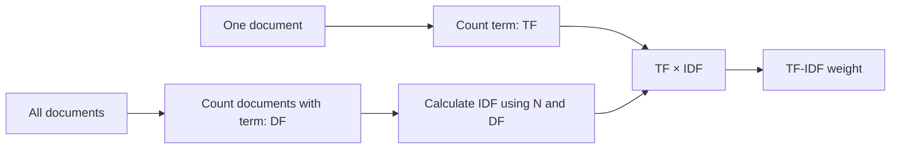
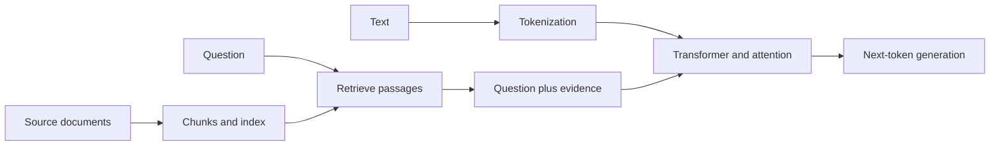

# Day 1 — NLP, LLMs, and RAG

The examples use Python's standard library. Tiny examples show the idea; they do not train real language models. Each topic has two exercises: Exercise 1 walks through a problem step by step; Exercise 2 uses Python code and shows the output.

## 1. NLP and tokenization

- **Natural language processing (NLP):** methods that help computers process human language.
- **Token:** a piece of text a model reads, such as a word, word part, or punctuation mark.
- **Tokenization:** splitting text into tokens.

### Exercise 1

Treat each word as one token. Split `AI learns from data` and count the tokens.

**Step-by-step solution:**

1. The instruction says to treat each whole word as one token.
2. Split at the spaces: `AI` | `learns` | `from` | `data`.
3. Count the pieces: there are **4 tokens**. Real tokenizers may split a word into smaller pieces.

### Exercise 2: split text into simple word tokens

This uses Python's `split()`, not a production model tokenizer.

```python
text = "Cats chase cats."
tokens = text.lower().replace(".", "").split()

print(tokens)
print("token count:", len(tokens))
```

Output:

```text
['cats', 'chase', 'cats']
token count: 3
```

`split()` makes one token per word here. Real tokenizers may split a word like `unhappy` into `un` and `happy`.

**Try:** Change the sentence and count its tokens.

## 2. Bag of Words and TF-IDF

- **Bag of Words (BoW):** represents a document by counting its words; word order is ignored.
- **TF-IDF:** **Term Frequency–Inverse Document Frequency**, a word-weighting method that favors terms frequent in one document but rare across the collection.

For a term `t` (a word) in document `d`, this note uses:

- `TF(t, d) = count of t in d`: **term frequency** in the current document.
- `DF(t) = number of documents containing t`: **document frequency** across the collection; each document counts once.
- `N`: the total number of documents in the collection.
- `IDF(t) = ln((1 + N) / (1 + DF(t))) + 1`: **inverse document frequency**. `ln` is the natural logarithm; the `+1` smoothing keeps the value defined when a term is unseen.
- `TF-IDF(t, d) = TF(t, d) × IDF(t)`.

This is one common smoothed formula. Libraries may use different TF scaling or normalization.

### Exercise 1

Use the three documents in Exercise 2. For `mat` in the first document, calculate TF-IDF using the steps below.

**Step-by-step solution:**

1. Count `mat` in the first document, `cat sat mat`: it appears once, so `TF = 1`.
2. Count documents that contain `mat`: only the first document does, so `DF = 1`. There are `N = 3` documents in total.
3. Substitute into the formula: `IDF = ln((1 + N) / (1 + DF)) + 1 = ln(4 / 2) + 1`.
4. Simplify: `4 / 2 = 2`, and `ln(2) ≈ 0.69`. Therefore `IDF ≈ 0.69 + 1 = 1.69`.
5. Multiply by term frequency: `TF-IDF = TF × IDF = 1 × 1.69 = 1.69`.

### Exercise 2: compare common and distinctive words

```python
import math
from collections import Counter

documents = ["cat sat mat", "cat ate fish", "dog sat log"]
tokenized = [document.split() for document in documents]
term_frequency = Counter(tokenized[0])  # TF in the first document
N = len(tokenized)  # number of documents

def document_frequency(term):
    return sum(term in document for document in tokenized)

def inverse_document_frequency(term):
    DF = document_frequency(term)
    return math.log((1 + N) / (1 + DF)) + 1

print("BoW counts:", dict(sorted(term_frequency.items())))
for term in ("sat", "mat"):
    TF = term_frequency[term]
    DF = document_frequency(term)
    IDF = inverse_document_frequency(term)
    print(f"{term}: TF={TF}, DF={DF}, IDF={IDF:.2f}, TF-IDF={TF * IDF:.2f}")
```

Output:

```text
BoW counts: {'cat': 1, 'mat': 1, 'sat': 1}
sat: TF=1, DF=2, IDF=1.29, TF-IDF=1.29
mat: TF=1, DF=1, IDF=1.69, TF-IDF=1.69
```

For `mat`, `N = 3`, `DF = 1`, and `TF = 1`:

- `IDF = ln((1 + 3) / (1 + 1)) + 1 ≈ 1.69`.
- `TF-IDF = 1 × 1.69 = 1.69`.

`mat` gets more weight than `sat` because it appears in fewer documents. Neither BoW nor TF-IDF understands synonyms or word order.



**Try:** Add a document containing `mat` and compare the IDF values again.

## 3. Embeddings and similarity

- **Embedding:** a vector of numbers representing text. A trained model places related meanings near each other.
- **Cosine similarity:** a comparison of two vector directions; a value near `1` means the directions are similar.

The example uses made-up vectors to teach the comparison, not embedding training.

For vectors `a` and `b`, `cosine(a, b) = (a · b) / (||a|| × ||b||)`. The **dot product** `a · b` multiplies matching coordinates and adds them. `||a||` is the length of vector `a`, calculated as the square root of the sum of its squared coordinates.

### Exercise 1

For `a = [1, 0]` and `b = [0.8, 0.6]`, calculate cosine similarity. Both vector lengths are `1`.

**Step-by-step solution:**

1. Multiply matching coordinates and add: `a · b = (1 × 0.8) + (0 × 0.6) = 0.8`.
2. The length of `a` is `sqrt(1² + 0²) = 1`.
3. The length of `b` is `sqrt(0.8² + 0.6²) = sqrt(0.64 + 0.36) = sqrt(1) = 1`.
4. Divide the dot product by the two lengths: `cosine(a, b) = 0.8 / (1 × 1) = 0.8`.

### Exercise 2: compare two vectors

```python
import math

def cosine(a, b):
    dot = sum(x * y for x, y in zip(a, b))
    size_a = math.sqrt(sum(x * x for x in a))
    size_b = math.sqrt(sum(y * y for y in b))
    return dot / (size_a * size_b)

password = [1.0, 0.8, 0.0]
login = [0.9, 0.7, 0.1]
weather = [0.0, 0.0, 1.0]

print("password/login:", round(cosine(password, login), 2))
print("password/weather:", round(cosine(password, weather), 2))
```

Output:

```text
password/login: 1.0
password/weather: 0.0
```

The first pair points in a similar direction. Similarity helps retrieve related text, but does not prove that the text answers a question.

**Try:** Compare `password` with `[1, 0, 0]`.

## 4. Transformers and attention

- **Transformer:** a neural network architecture used by many language models.
- **Attention:** a calculation that decides how much information a token should use from other tokens.

It combines token information as `context = Σ(weightᵢ × valueᵢ)`:

- `weightᵢ`: how much attention token `i` receives.
- `valueᵢ`: the information vector for token `i`.
- `context`: the weighted information combined for the current token.

A real Transformer calculates weights from learned parameters. This exercise sets them by hand.

### Exercise 1

Attention gives value `4` a weight of `0.75` and value `0` a weight of `0.25`. Calculate the combined context.

**Step-by-step solution:**

1. Multiply each value by its attention weight: `0.75 × 4 = 3` and `0.25 × 0 = 0`.
2. Add the weighted values: `3 + 0 = 3`.
3. The combined context is **3**.

### Exercise 2: make a weighted context

The example creates context for `sat`, giving more weight to `cat`.

```python
tokens = ["cat", "sat", "mat"]
values = [[1.0, 0.0], [0.0, 1.0], [0.8, 0.2]]
weights_for_sat = [0.6, 0.1, 0.3]

context = [
    sum(weights_for_sat[i] * values[i][axis] for i in range(len(tokens)))
    for axis in range(2)
]
print("weight total:", sum(weights_for_sat))
print("context for sat:", [round(value, 2) for value in context])
```

Output:

```text
weight total: 1.0
context for sat: [0.84, 0.16]
```

The context contains mostly the information assigned to `cat`. This illustrates weighted combination, not a complete Transformer.

**Try:** Give `mat` a weight of `0.6` and reduce the `cat` weight to `0.3`.

## 5. LLMs, GPT, and BERT

- **Large language model (LLM):** a model trained on large text collections to learn language patterns.
- **GPT:** **Generative Pre-trained Transformer**; GPT-style models generate text by predicting the next token.
- **BERT:** **Bidirectional Encoder Representations from Transformers**; commonly used to represent or classify text.

The code below is a fixed toy predictor, not an LLM.

### Exercise 1

A next-token table says `AI → learns` and `AI learns → patterns`. Write the result after two predictions. Then fill `[MASK]` in `The [MASK] shines` using the clue `sun`.

**Step-by-step solution:**

1. Start with `AI`. The table maps `AI` to `learns`, so the text becomes `AI learns`.
2. The table maps `AI learns` to `patterns`, so the final text is `AI learns patterns`.
3. In `The [MASK] shines`, replace `[MASK]` with the given clue `sun`: `The sun shines`.

### Exercise 2: generate tokens one at a time

```python
next_token = {
    "AI": "can",
    "AI can": "help",
    "AI can help": "students",
}
tokens = ["AI"]

for _ in range(3):
    context = " ".join(tokens)
    tokens.append(next_token[context])
    print(" ".join(tokens))
```

Output:

```text
AI can
AI can help
AI can help students
```

Real LLMs choose from a large vocabulary using learned probabilities. Fluent output can still be false, so verify important claims.

**Try:** Add a fourth entry to `next_token` and generate one more token.

#### BERT masked-token example

BERT is commonly trained to predict a hidden token using words on both sides. This lookup is a toy illustration, not a BERT model.

```python
masked_text = "The cat [MASK] on the mat"
toy_prediction = {
    "The cat [MASK] on the mat": "sat",
}
print("input:", masked_text)
print("filled token:", toy_prediction[masked_text])
```

Output:

```text
input: The cat [MASK] on the mat
filled token: sat
```

**Remember:** GPT-style generation predicts what comes next; BERT-style masked prediction uses context on both sides of a missing token.

## 6. RAG: retrieve before answering

- **Retrieval-augmented generation (RAG):** retrieves source passages and gives them to an LLM as context for an answer.
- **Chunk:** a short section of a document that can be indexed and retrieved.

The example uses keyword overlap, not semantic search.

### Exercise 1

Question words are `{llm, source}`. Passage A is `LLM reads source text`; passage B is `source contains facts`. Count matching words and choose a passage.

**Step-by-step solution:**

1. The question words are `llm` and `source`.
2. Passage A, `LLM reads source text`, contains both words: **2 matches**.
3. Passage B, `source contains facts`, contains only `source`: **1 match**.
4. Passage A has more matches, so retrieve **Passage A**.

### Exercise 2: retrieve the best matching passage

```python
chunks = [
    "RAG searches useful passages",
    "An LLM reads retrieved passages",
    "The model answers questions",
]
question_words = {"llm", "reads"}

ranked = sorted(
    chunks,
    key=lambda chunk: len(question_words.intersection(chunk.lower().split())),
    reverse=True,
)
print("best passage:", ranked[0])
```

Output:

```text
best passage: An LLM reads retrieved passages
```

RAG can ground an answer in retrieved sources, but bad retrieval or generation can still cause errors. Check citations against the source.

**Try:** Change `question_words` to `{ "model", "answers" }` and see which passage ranks first.

## 7. Prompts, context, and unsupported claims

- **Prompt:** the instructions and information sent to a model.
- **Context window:** the amount of text a model can process in one request.
- **Hallucination:** generated content that is unsupported or false.

### Exercise 1

A context window holds 6 words. The source is `The meeting starts at 10 AM in room four`. What detail is cut off?

**Step-by-step solution:**

1. Count the words from the start: `The(1) meeting(2) starts(3) at(4) 10(5) AM(6)`.
2. The six-word limit ends after `AM`, so the available context is `The meeting starts at 10 AM`.
3. `in room four` comes after the limit and is missing. The model cannot use this context to claim which room the meeting is in.

### Exercise 2: check an answer against a source

This toy limit counts words; real models count tokens. The word check is only a warning: matching words does not prove an answer is true.

```python
source = "The workshop begins at 9 AM in Room 4."
answer = "The workshop begins at 9 AM in Room 5."
context_window_words = 7
context = " ".join(source.split()[:context_window_words])
prompt = f"Answer using only this context: {context}"

def words(text):
    return {word.strip(".,!? ").lower() for word in text.split()}

missing = words(answer) - words(context) - {"the", "at", "in"}
print("prompt:", prompt)
print("unsupported words:", sorted(missing))
```

Output:

```text
prompt: Answer using only this context: The workshop begins at 9 AM in
unsupported words: ['5', 'room']
```

The context limit cuts off `Room 4`, so the checker flags both `room` and `5`. Real verification must check meaning, not just word overlap.

**Try:** Change the answer to `The workshop begins at 9 AM.`

## Day 1: how the pieces connect



## Day 1 recap

Tokenization splits text into model-readable pieces. BoW and TF-IDF count words; embeddings compare learned representations. Transformers use attention, and GPT-style models generate tokens. RAG retrieves source passages to provide context. Check generated answers against their evidence.

