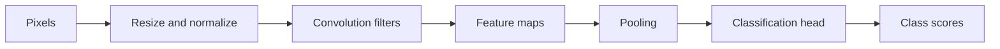

# Day 2 — Computer Vision, CNNs, and Classification

Examples use Python 3 and its standard library. The CNN calculations are small illustrations; real CNNs use learned filters and image libraries.

## 1. Pixels, dimensions, RGB, and grayscale

An image is a grid of **pixels**. Dimensions are width × height. Each RGB pixel has red, green, and blue values, often 0–255. Grayscale uses one brightness value per pixel. This example uses the simple average formula: `gray = (red + green + blue) / 3`. Other conversions use weighted channel values because our eyes respond differently to each color.

### Exercise: inspect a tiny RGB image

Steps:

1. Create a 2-row, 2-column image. Each pixel is an RGB tuple.
2. Print image height and width.
3. Read the top-left pixel and convert it to grayscale using average brightness.

```python
image = [
    [(255, 0, 0), (0, 255, 0)],
    [(0, 0, 255), (255, 255, 255)],
]
height = len(image)
width = len(image[0])
red, green, blue = image[0][0]
gray = round((red + green + blue) / 3)

print("width:", width, "height:", height)
print("top-left RGB:", image[0][0])
print("top-left grayscale:", gray)
```

Expected output:

```text
width: 2 height: 2
top-left RGB: (255, 0, 0)
top-left grayscale: 85
```

## 2. Preprocessing: resize, filter, threshold, edges

**Preprocessing** prepares an image for a model. Resizing changes dimensions; filtering smooths noise; thresholding turns brightness into categories; edge detection highlights sharp brightness changes. Use the preprocessing expected by the model.

### Exercise: apply three simple preprocessing operations

We will use a small grayscale image. The resize selects every second pixel (a tiny nearest-neighbor example); the blur is a simple average; the edge calculation uses differences between neighbors.

Steps:

1. Resize the four-pixel row to two pixels by selecting every second pixel.
2. Threshold each original pixel at 128 to make a black-and-white image.
3. Average each pair of neighboring pixels to create a simple blurred row.
4. Calculate absolute differences to highlight edges, then print each result.

```python
row = [0, 40, 220, 240]
resized = row[::2]
thresholded = [255 if pixel >= 128 else 0 for pixel in row]
blurred = [round((row[i] + row[i + 1]) / 2) for i in range(len(row) - 1)]
edges = [abs(row[i + 1] - row[i]) for i in range(len(row) - 1)]

print("original:", row)
print("resized:", resized)
print("threshold:", thresholded)
print("neighbor averages:", blurred)
print("edge strength:", edges)
```

Expected output:

```text
original: [0, 40, 220, 240]
resized: [0, 220]
threshold: [0, 0, 255, 255]
neighbor averages: [20, 130, 230]
edge strength: [40, 180, 20]
```

The large difference of 180 marks a strong edge. These are teaching examples, not production image filters.

## 3. Convolution, filters, and feature maps

A CNN applies a small grid called a **filter** or **kernel** across an image. At each position it multiplies nearby pixel values by filter weights and adds them: `output[row, col] = Σ(image[row+i, col+j] × kernel[i, j])`. The responses form a **feature map**. A learned filter may respond to edges or other visual patterns.

### Exercise: convolve a 3×3 image

The filter below finds a vertical brightness change. The output is one number because the 2×2 filter fits in one position.

Steps:

1. Multiply corresponding image and filter values.
2. Add the four products.
3. Print the feature-map response.

```python
image = [
    [1, 2, 0],
    [3, 4, 1],
    [0, 1, 2],
]
kernel = [
    [-1, 1],
    [-1, 1],
]

response = sum(
    image[row][col] * kernel[row][col]
    for row in range(2)
    for col in range(2)
)
print("feature response:", response)
```

Expected output:

```text
feature response: 2
```

For a larger image, the filter slides to multiple positions and creates a larger feature map.

## 4. Pooling and classification head

**Pooling** shrinks a feature map by summarizing small regions, often by keeping their largest value. A **classification head** turns final features into class scores. Softmax turns scores `z` into values `pᵢ = exp(zᵢ) / Σ exp(zⱼ)` that sum to one, but those values are not always calibrated probabilities.

### Exercise: max-pool, then calculate class probabilities

Steps:

1. Split the feature map into pairs and keep each pair’s maximum (max pooling).
2. Use a tiny set of class scores as if produced by a classification head.
3. Apply softmax: exponentiate each score and divide by their sum.
4. Print pooled features and probabilities.

```python
import math

feature_map = [1, 5, 2, 4]
pooled = [max(feature_map[i:i + 2]) for i in range(0, len(feature_map), 2)]
scores = [2.0, 1.0]  # cat score, dog score (example scores)
exp_scores = [math.exp(score) for score in scores]
total = sum(exp_scores)
probabilities = [round(value / total, 2) for value in exp_scores]

print("pooled features:", pooled)
print("cat, dog scores:", scores)
print("cat, dog softmax:", probabilities)
```

Expected output:

```text
pooled features: [5, 4]
cat, dog scores: [2.0, 1.0]
cat, dog softmax: [0.73, 0.27]
```



## 5. Transfer learning

**Transfer learning** reuses a model trained on many images. **Feature extraction** keeps its image layers fixed and trains a new final classifier. **Fine-tuning** also updates some image layers. It can adapt better but needs care and enough data.

### Exercise: simulate replacing a classifier head

This code does not train a CNN. It demonstrates the idea: reuse the same feature values, then change the mapping to the task’s labels.

Steps:

1. Treat `[edge strength, color strength]` as features produced by a pretrained model.
2. Use a small task-specific table to score two new classes.
3. Print which class has the largest score.
4. Change the feature values and observe how the class changes.

```python
features = [0.9, 0.2]  # reused visual features
head = {
    "flower": [1.0, 0.2],
    "leaf": [0.2, 1.0],
}
scores = {
    label: sum(a * b for a, b in zip(features, weights))
    for label, weights in head.items()
}
prediction = max(scores, key=scores.get)
print("scores:", {name: round(score, 2) for name, score in scores.items()})
print("predicted class:", prediction)
```

Expected output:

```text
scores: {'flower': 0.94, 'leaf': 0.38}
predicted class: flower
```

Here the table stands in for a trained classifier head. In a real project, use a pretrained model and train its new head on labeled examples.

## 6. Confusion matrix and evaluation metrics

For a positive class, **TP** means correctly found positive, **FP** means a false alarm, **FN** means a missed positive, and **TN** means correctly identified negative.

- Accuracy = `(TP + TN) / (TP + TN + FP + FN)`
- Precision = `TP / (TP + FP)` — how often positive predictions are right
- Recall = `TP / (TP + FN)` — how many actual positives were found
- F1-score = `2 × precision × recall / (precision + recall)` — balances precision and recall

### Exercise: calculate the metrics from predictions

Steps:

1. Compare each predicted label with the actual label.
2. Count TP, FP, FN, and TN.
3. Use the counts to calculate all four metrics.

```python
actual =    ["cat", "cat", "cat", "dog", "dog", "dog", "dog", "dog"]
predicted = ["cat", "dog", "cat", "dog", "cat", "dog", "dog", "dog"]
positive = "cat"

tp = sum(a == positive and p == positive for a, p in zip(actual, predicted))
fp = sum(a != positive and p == positive for a, p in zip(actual, predicted))
fn = sum(a == positive and p != positive for a, p in zip(actual, predicted))
tn = sum(a != positive and p != positive for a, p in zip(actual, predicted))

accuracy = (tp + tn) / len(actual)
precision = tp / (tp + fp)
recall = tp / (tp + fn)
f1 = 2 * precision * recall / (precision + recall)
print("TP, FP, FN, TN:", tp, fp, fn, tn)
print("accuracy:", round(accuracy, 2))
print("precision:", round(precision, 2))
print("recall:", round(recall, 2))
print("F1:", round(f1, 2))
```

Expected output:

```text
TP, FP, FN, TN: 2 1 1 4
accuracy: 0.75
precision: 0.67
recall: 0.67
F1: 0.67
```

## Day 2 practical

Use a pretrained CNN to classify sample images: load image → apply the model’s resize and normalization → run inference → print class and score → compare with the correct label. Inspect mistakes and consider blur, lighting, hidden objects, and missing training examples.

## Day 2 recap

Images are numeric pixel grids. Preprocessing prepares them; convolution filters create feature maps; pooling shrinks them; a classification head scores labels. Transfer learning reuses learned features. Use precision and recall to understand errors.


