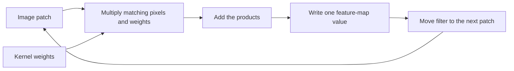
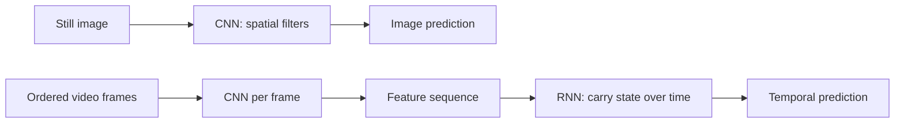
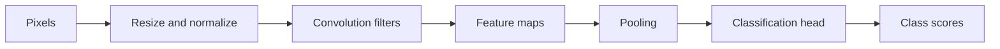

# Day 2 — Computer Vision and CNNs

The examples use Python's standard library and tiny numeric images. Each topic has two exercises: Exercise 1 works through a question step by step; Exercise 2 demonstrates the concept with Python code and output. These examples teach the calculations; they do not train real vision models. Try the change at the end to check your understanding.

## 1. Pixels, color, and image shape

- **Pixel:** one cell in a digital image grid. It stores a color or brightness value.
- **RGB:** a color format with red, green, and blue values, often from `0` to `255` per channel.
- **Grayscale:** an image format with one brightness value per pixel.
- **Image shape:** the dimensions, usually written as `height × width × channels`.
- **Channels:** the values stored per pixel; RGB has three channels and grayscale usually has one.

### Exercise 1

An image is 3 pixels high, 4 pixels wide, and RGB. How many channel values does it contain? A pixel is `(9, 12, 15)`; find its average grayscale value.

**Step-by-step solution:**

1. The image has `3 × 4 = 12` pixels.
2. Each RGB pixel stores 3 values: red, green, and blue. So the image stores `12 × 3 = 36` channel values.
3. For the sample pixel, add its channels: `9 + 12 + 15 = 36`.
4. Divide by 3 channels: `36 / 3 = 12`. Its average grayscale value is **12**.

### Exercise 2: inspect a tiny RGB image

```python
image = [
    [(255, 0, 0), (0, 255, 0)],
    [(0, 0, 255), (255, 255, 255)],
]

height = len(image)
width = len(image[0])
red, green, blue = image[0][0]
gray = round((red + green + blue) / 3)

print("shape:", height, "x", width, "x 3")
print("top-left RGB:", image[0][0])
print("top-left gray:", gray)
```

Output:

```text
shape: 2 x 2 x 3
top-left RGB: (255, 0, 0)
top-left gray: 85
```

The grayscale conversion here uses a simple average. Real conversions often weight colors differently.

**Try:** Use the white pixel `image[1][1]`; what grayscale value do you get?

## 2. Image preprocessing

- **Preprocessing:** changes an image into the input format a model expects.
- **Resizing:** changes an image's width and height.
- **Normalization:** rescales pixel values, often to the range `0` to `1`.

Use the same preprocessing at prediction time that the model used during training.

### Exercise 1

Normalize pixel `128` by dividing by `255`, rounded to two decimals. If a resize keeps every second value from `[0, 100, 200, 255]`, what values remain?

**Step-by-step solution:**

1. Normalization divides the pixel by the largest 8-bit value: `128 / 255 ≈ 0.50196`.
2. Round to two decimal places: `0.50`.
3. Keeping every second value means keeping positions `0` and `2` in `[0, 100, 200, 255]`.
4. Those values are `0` and `200`, so the resized row is **`[0, 200]`**.

### Exercise 2: resize and normalize a pixel row

```python
row = [0, 40, 220, 240]
resized = row[::2]  # take every second pixel
normalized = [round(pixel / 255, 2) for pixel in row]

print("resized:", resized)
print("normalized:", normalized)
```

Output:

```text
resized: [0, 220]
normalized: [0.0, 0.16, 0.86, 0.94]
```

This is a tiny demonstration; real resizing considers neighboring pixels rather than simply dropping most of them.

**Try:** Normalize the resized row instead.

## 3. Convolution and feature maps

- **Convolution:** slide a small grid of weights over an image and calculate one weighted sum at each position.
- **Filter** (or **kernel**): the small grid of weights applied to each image patch.
- **Feature map:** the grid of sums showing how strongly the filter responds at each image position.
- **Stride:** how many pixels the filter moves each step.
- **Padding:** extra border pixels added around the image so filters can cover edge regions.

At each position, multiply matching pixels and weights, then add the products. The results fill the feature map.

For the code's simple case (stride `1`, no padding), input image `I`, kernel `K`, and output location `(r, c)` give this weighted sum:

`F[r, c] = Σᵢ Σⱼ I[r + i, c + j] × K[i, j]`

In the formula:

- `F[r, c]` is one feature-map value at output location `(r, c)`.
- `I[r+i, c+j]` is the input pixel at that patch position.
- `K[i, j]` is the matching kernel weight; `i` and `j` move through kernel rows and columns.

Deep-learning libraries commonly call this convolution; technically, this sliding form does not flip the kernel.

For one image dimension, output size is `floor((H + 2P - K) / S) + 1`:

- `H`: input size; `K`: kernel size.
- `P`: padding pixels added to each side; `S`: stride (how far the filter moves).
- `floor` means round down.

Here, `H=3`, `K=2`, `P=0`, and `S=1`, so the output size is `2`.

### Exercise 1

Use the top-left image patch `[[1, 2], [3, 4]]` and kernel `[[-1, 1], [-1, 1]]`. Calculate the feature-map value.

**Step-by-step solution:**

1. Match each image value with the kernel value in the same position: `1` with `-1`, `2` with `1`, `3` with `-1`, and `4` with `1`.
2. Multiply each pair: `1 × -1 = -1`, `2 × 1 = 2`, `3 × -1 = -3`, and `4 × 1 = 4`.
3. Add the products: `-1 + 2 - 3 + 4 = 2`.
4. The feature-map value at this position is **2**.

### Exercise 2: slide a filter across a 3×3 image

```python
image = [
    [1, 2, 0],
    [3, 4, 1],
    [0, 1, 2],
]
kernel = [
    [-1, 1],
    [-1, 1],
]

feature_map = []
for row in range(len(image) - 1):
    output_row = []
    for col in range(len(image[0]) - 1):
        total = sum(
            image[row + i][col + j] * kernel[i][j]
            for i in range(2)
            for j in range(2)
        )
        output_row.append(total)
    feature_map.append(output_row)

print(feature_map)
```

Output:

```text
[[2, -5], [2, -2]]
```

At the top-left position, the calculation is `1×(-1) + 2×1 + 3×(-1) + 4×1 = 2`. The filter moves one pixel at a time (**stride 1**) and uses no added border (**padding 0**), so the 3×3 input produces a 2×2 feature map. This filter responds to left-to-right brightness changes.

**How this becomes a CNN:** Convolution is one operation. A **convolutional neural network (CNN)** is a full neural network built from layers that apply learned filters, activations, and often pooling before a prediction layer.



**Try:** Change one kernel weight and observe how the feature map changes.

## 4. Pooling

**Pooling** summarizes small areas of a feature map to make it smaller. **Max pooling** keeps the largest value in each area.

### Exercise 1

Apply max pooling to the 2×2 patch `[[1, 5], [3, 0]]`.

**Step-by-step solution:**

1. Read all four values in the patch: `1`, `5`, `3`, and `0`.
2. Compare them: the largest value is `5`.
3. Max pooling keeps that largest value, so this patch becomes **`5`**.

### Exercise 2: max-pool 2×2 regions

```python
feature_map = [
    [1, 5, 2, 4],
    [3, 0, 7, 6],
    [8, 2, 1, 0],
    [4, 9, 3, 5],
]

pooled = []
for row in range(0, 4, 2):
    pooled_row = []
    for col in range(0, 4, 2):
        block = [
            feature_map[row][col], feature_map[row][col + 1],
            feature_map[row + 1][col], feature_map[row + 1][col + 1],
        ]
        pooled_row.append(max(block))
    pooled.append(pooled_row)

print(pooled)
```

Output:

```text
[[5, 7], [9, 5]]
```

The 4×4 map becomes 2×2. Pooling reduces the amount of data passed to later layers.

**Try:** Replace `max(block)` with `min(block)` and compare.

## 5. Classification scores and softmax

- **Classification head:** turns image features into one score per class.
- **Softmax:** converts class scores into values that sum to `1`:

`pᵢ = eᶻⁱ / Σⱼ eᶻʲ`

- `zᵢ`: the score for class `i`.
- `e`: the base of the natural exponential.
- `Σⱼ eᶻʲ`: add the exponentiated scores for all classes.
- `pᵢ`: the resulting softmax value for class `i`.

Softmax values are not automatically reliable probabilities.

### Exercise 1

For cat and dog scores `[2, 1]`, use `e² ≈ 7.39` and `e¹ ≈ 2.72`. Calculate the two softmax values to two decimals.

**Step-by-step solution:**

1. Softmax first exponentiates each score. The question gives `e² ≈ 7.39` for cat and `e¹ ≈ 2.72` for dog.
2. Add those values to get the shared denominator: `7.39 + 2.72 = 10.11`.
3. Divide cat's value by the total: `7.39 / 10.11 ≈ 0.73`.
4. Divide dog's value by the total: `2.72 / 10.11 ≈ 0.27`.
5. The answers are **cat `0.73`** and **dog `0.27`**; together they sum to `1.00` (allowing for rounding).

### Exercise 2: convert two class scores

```python
import math

scores = [2.0, 1.0]  # cat, dog
exp_scores = [math.exp(score) for score in scores]
total = sum(exp_scores)
probabilities = [round(value / total, 2) for value in exp_scores]

print("cat, dog:", probabilities)
print("sum:", sum(probabilities))
```

Output:

```text
cat, dog: [0.73, 0.27]
sum: 1.0
```

The cat score is higher, so the model would choose `cat`. Softmax does not prove that the cat label is correct.

**Try:** Swap the two scores and see which class ranks first.

## 6. CNNs and transfer learning

- **Convolutional neural network (CNN):** a neural network that applies learned filters across an image to detect spatial patterns.
- **Neural network:** layers of calculations with adjustable weights.

During supervised CNN training:

1. The network predicts a label from the image.
2. It compares that prediction with the correct label to measure error.
3. **Backpropagation** estimates how each weight contributed to the error.
4. An **optimizer** updates the weights to reduce future error.

The same filter is reused across image locations, helping detect a pattern wherever it appears. A convolution layer often adds a bias, then applies an **activation function**. ReLU (**Rectified Linear Unit**) is `max(0, value)`: it changes negative results to zero and keeps positive results. Activations let stacked layers learn more complex patterns than simple sums alone.

- **Transfer learning:** adapts a model already trained on other images.
- **Feature extraction:** freezes the model's image layers and trains a new classifier.
- **Fine-tuning:** also updates some of the pretrained image layers.

### Exercise 1

Use features `[0.9, 0.2]`. The flower weights are `[1, 0.2]`; the leaf weights are `[0.2, 1]`. Multiply matching values and add to find each score. Which class wins?

**Step-by-step solution:**

1. For flower, multiply matching values and add: `(0.9 × 1) + (0.2 × 0.2) = 0.9 + 0.04 = 0.94`.
2. For leaf, do the same: `(0.9 × 0.2) + (0.2 × 1) = 0.18 + 0.2 = 0.38`.
3. Compare the scores: `0.94 > 0.38`.
4. The classifier chooses **flower** because it has the higher score.

### Exercise 2: use fixed features with a new classifier

This toy table stands in for learned model weights; it does not train a CNN.

```python
features = [0.9, 0.2]  # output from a reused image model
new_head = {
    "flower": [1.0, 0.2],
    "leaf": [0.2, 1.0],
}

scores = {
    label: sum(a * b for a, b in zip(features, weights))
    for label, weights in new_head.items()
}
prediction = max(scores, key=scores.get)
print("scores:", {label: round(score, 2) for label, score in scores.items()})
print("prediction:", prediction)
```

Output:

```text
scores: {'flower': 0.94, 'leaf': 0.38}
prediction: flower
```

The reused model supplies features; the new head maps them to task labels. In real transfer learning, the head is trained on labeled examples.

**Try:** Change the features to `[0.2, 0.9]`.

## 7. CNNs and RNNs for image tasks

- **Recurrent neural network (RNN):** a network that processes an ordered sequence and carries information from earlier steps forward.
- **Hidden state:** the information an RNN carries from one step to the next.

This exercise uses the simplified rule `hₜ = xₜ + 0.5 × hₜ₋₁`, with starting state `h₀ = 0`:

- `xₜ` is the current input feature.
- `hₜ` is the new state at step `t`; `hₜ₋₁` is the previous state.
- `0.5` is a made-up weight that makes carry-over easy to see.

| Network | Best fit | Image example |
| --- | --- | --- |
| CNN | Spatial patterns in a grid | Classify, detect, or segment objects in a still image |
| RNN | Ordered data that changes over time | Track video-frame features or generate caption words from CNN features |

For a still image, a CNN is a natural fit because it processes local 2D patterns. For video, a CNN can extract features from each frame and an RNN can process that feature sequence over time. For image captioning, a CNN can encode the image and an RNN can produce words from those features. RNNs are not required for images; modern systems also use architectures such as Transformers.

### Exercise 1

Use `hₜ = xₜ + 0.5 × hₜ₋₁`, start with `h₀=0`, and process features `[2, 0, 0]`. Find each new state.

**Step-by-step solution:**

1. Start with `h₀ = 0`. For input `x₁ = 2`, calculate `h₁ = x₁ + 0.5 × h₀ = 2 + 0.5 × 0 = 2`.
2. For input `x₂ = 0`, use the previous state `h₁ = 2`: `h₂ = 0 + 0.5 × 2 = 1`.
3. For input `x₃ = 0`, use the previous state `h₂ = 1`: `h₃ = 0 + 0.5 × 1 = 0.5`.
4. The states are **`h₁ = 2`, `h₂ = 1`, and `h₃ = 0.5`**.

### Exercise 2: carry information through a sequence

This toy recurrence illustrates an RNN state. A real RNN learns weights and uses vector-valued states.

```python
frame_features = [2, 3, 4]  # one value from each successive video frame
hidden_state = 0

for step, feature in enumerate(frame_features, start=1):
    hidden_state = feature + 0.5 * hidden_state
    print("step", step, "state:", hidden_state)
```

Output:

```text
step 1 state: 2.0
step 2 state: 4.0
step 3 state: 6.0
```

The current frame contributes its feature; the previous state carries earlier information forward.

**Try:** Change `frame_features` to `[2, 0, 0]`. The later states still contain information from the first frame.



## 8. Evaluate predictions

A **confusion matrix** counts correct and incorrect predictions. For a chosen positive class, **TP** is a correctly found positive, **FP** a false alarm, **FN** a missed positive, and **TN** a correctly rejected negative.

- **Precision** = `TP / (TP + FP)`: how many positive predictions were right.
- **Recall** = `TP / (TP + FN)`: how many actual positives were found.
- **Accuracy** = `(TP + TN) / total`: how many predictions were right overall.
- **F1** balances precision and recall: `2 × precision × recall / (precision + recall)`.

### Exercise 1

Given `TP=2`, `FP=1`, `FN=1`, and `TN=4`, calculate precision, recall, accuracy, and F1.

**Step-by-step solution:**

1. Precision asks what fraction of positive predictions were correct: `TP / (TP + FP) = 2 / (2 + 1) = 2/3 ≈ 0.67`.
2. Recall asks what fraction of actual positives were found: `TP / (TP + FN) = 2 / (2 + 1) = 2/3 ≈ 0.67`.
3. There are `2 + 1 + 1 + 4 = 8` examples. Six are correct (`TP + TN = 2 + 4`), so accuracy is `6/8 = 0.75`.
4. F1 is `2 × precision × recall / (precision + recall)`. Since precision and recall are both `2/3`, F1 is `2 × (2/3) × (2/3) / (2/3 + 2/3) = 2/3 ≈ 0.67`.

### Exercise 2: calculate metrics for cat predictions

```python
actual =    ["cat", "cat", "cat", "dog", "dog", "dog", "dog", "dog"]
predicted = ["cat", "dog", "cat", "dog", "cat", "dog", "dog", "dog"]
positive = "cat"

tp = sum(a == positive and p == positive for a, p in zip(actual, predicted))
fp = sum(a != positive and p == positive for a, p in zip(actual, predicted))
fn = sum(a == positive and p != positive for a, p in zip(actual, predicted))
tn = sum(a != positive and p != positive for a, p in zip(actual, predicted))

precision = tp / (tp + fp)
recall = tp / (tp + fn)
accuracy = (tp + tn) / len(actual)
f1 = 2 * precision * recall / (precision + recall)
print("TP, FP, FN, TN:", tp, fp, fn, tn)
print("precision, recall, accuracy, F1:",
      round(precision, 2), round(recall, 2), round(accuracy, 2), round(f1, 2))
```

Output:

```text
TP, FP, FN, TN: 2 1 1 4
precision, recall, accuracy, F1: 0.67 0.67 0.75 0.67
```

Accuracy alone can hide poor performance when one class is rare. Pick metrics based on which mistakes matter most.

**Try:** Change one predicted `dog` to `cat`. Recalculate precision and recall.

## Day 2: how a CNN processes an image



## Day 2 recap

Images are grids of pixel values. Preprocessing prepares them for a model. A CNN applies learned filters to create feature maps, then pooling and a classification head reduce and score them. CNNs suit spatial image patterns; RNNs carry information through ordered sequences such as video frames. Transfer learning reuses learned features. Precision, recall, and accuracy describe different kinds of errors.

