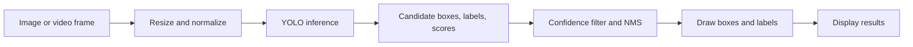

# Day 3 — Object Detection and AI Applications

Examples use Python 3 and only its standard library. They teach the calculations around detection; they do not run a trained vision model.

## 1. Classification, detection, segmentation, and boxes

- **Classification:** gives a label to a whole image.
- **Detection:** gives each object a label and a rectangular location.
- **Segmentation:** labels the pixels belonging to each object.

A **bounding box** is often `(x_min, y_min, x_max, y_max)`. Coordinates may use pixels or normalized values, so check the model’s format.

### Exercise: calculate a box’s size and center

Steps:

1. Read the box coordinates.
2. Subtract minimum from maximum to find width and height.
3. Average each pair of coordinates to find the center.
4. Print the values.

```python
x_min, y_min, x_max, y_max = 10, 20, 50, 80
width = x_max - x_min
height = y_max - y_min
center_x = (x_min + x_max) / 2
center_y = (y_min + y_max) / 2
print("size:", width, "x", height)
print("center:", center_x, center_y)
```

Expected output:

```text
size: 40 x 60
center: 30.0 50.0
```

## 2. Intersection over Union (IoU)

**IoU** measures how much a predicted box overlaps a ground-truth box:

`IoU = intersection area / union area`

It is 0 for no overlap and 1 for identical boxes. Evaluators often require IoU to exceed a chosen threshold for a detection to count as correct.

### Exercise: write an IoU function

Steps:

1. Find the intersection’s left, top, right, and bottom edges.
2. If edges do not overlap, intersection area is zero.
3. Calculate each area and the union (`area A + area B - intersection`).
4. Divide intersection by union and try two box pairs.

```python
def area(box):
    x1, y1, x2, y2 = box
    return max(0, x2 - x1) * max(0, y2 - y1)

def iou(a, b):
    left = max(a[0], b[0])
    top = max(a[1], b[1])
    right = min(a[2], b[2])
    bottom = min(a[3], b[3])
    intersection = max(0, right - left) * max(0, bottom - top)
    union = area(a) + area(b) - intersection
    return intersection / union if union else 0

truth = (0, 0, 4, 4)
overlapping_prediction = (2, 0, 6, 4)
separate_prediction = (5, 5, 7, 7)
print("overlap IoU:", round(iou(truth, overlapping_prediction), 2))
print("separate IoU:", round(iou(truth, separate_prediction), 2))
```

Expected output:

```text
overlap IoU: 0.33
separate IoU: 0.0
```

## 3. YOLO, confidence, and duplicate boxes

**YOLO** (“You Only Look Once”) is a family of detectors designed to predict boxes and classes in one model pass. A detection includes a **confidence score**; high confidence does not guarantee correctness. Detectors can produce duplicate boxes for one object.

**Non-maximum suppression (NMS)** sorts boxes by score and removes lower-scoring boxes that overlap too much with a stronger box of the same class.

### Exercise: confidence filtering and simple NMS

Steps:

1. Remove detections below the confidence threshold.
2. Sort the remaining boxes from highest score to lowest.
3. Keep the strongest box; remove a later box of the same class when its IoU is above the overlap threshold.
4. Print the boxes left after NMS.

```python
def area(box):
    return max(0, box[2] - box[0]) * max(0, box[3] - box[1])

def iou(a, b):
    left, top = max(a[0], b[0]), max(a[1], b[1])
    right, bottom = min(a[2], b[2]), min(a[3], b[3])
    intersection = max(0, right - left) * max(0, bottom - top)
    union = area(a) + area(b) - intersection
    return intersection / union if union else 0

detections = [
    {"label": "cat", "score": 0.92, "box": (0, 0, 10, 10)},
    {"label": "cat", "score": 0.80, "box": (1, 1, 11, 11)},
    {"label": "dog", "score": 0.35, "box": (20, 20, 30, 30)},
]
score_threshold = 0.5
iou_threshold = 0.5
candidates = sorted(
    [d for d in detections if d["score"] >= score_threshold],
    key=lambda d: d["score"],
    reverse=True,
)

kept = []
for candidate in candidates:
    duplicate = any(
        candidate["label"] == chosen["label"]
        and iou(candidate["box"], chosen["box"]) > iou_threshold
        for chosen in kept
    )
    if not duplicate:
        kept.append(candidate)

print([(d["label"], d["score"], d["box"]) for d in kept])
```

Expected output:

```text
[('cat', 0.92, (0, 0, 10, 10))]
```

The dog was filtered by score. The second cat box was suppressed because it overlapped the first cat box strongly. Production NMS implementations handle many more details.



## 4. Multimodal AI, OCR, and image captions

**Multimodal AI** works with more than one data type, such as images and text. **OCR** reads text from an image. **Image captioning** creates a short text description. These models may miss details, especially with blur, handwriting, or unusual scenes.

### Exercise: inspect OCR output

OCR requires an image model. This exercise shows how to use its returned text and detect a simple missing-field problem.

Steps:

1. Store text that an OCR tool might return from a receipt.
2. Check whether the text includes a date and total marker.
3. Print the fields found and identify what needs human review.

```python
ocr_text = "SHOP ABC\n2026-10-20\nTOTAL 12.50"
lines = ocr_text.splitlines()
date = next((line for line in lines if line.startswith("202")), None)
total = next((line for line in lines if "TOTAL" in line), None)
print("date:", date)
print("total:", total)
print("needs review:", date is None or total is None)
```

Expected output:

```text
date: 2026-10-20
total: TOTAL 12.50
needs review: False
```

## 5. Deployment: latency and throughput

**Inference** means using a trained model to make predictions. **Latency** is time for one result; **throughput** is results per second. Image transfer, preprocessing, model size, and hardware can all affect speed. A smaller input or model may be faster but can reduce accuracy.

### Exercise: measure average latency and throughput

Steps:

1. Store three example inference times in milliseconds.
2. Calculate their average latency.
3. Convert average milliseconds to seconds and calculate frames per second.
4. Print both values.

```python
times_ms = [40, 50, 60]
average_ms = sum(times_ms) / len(times_ms)
frames_per_second = 1000 / average_ms
print("average latency:", average_ms, "ms")
print("approx throughput:", round(frames_per_second, 1), "frames/second")
```

Expected output:

```text
average latency: 50.0 ms
approx throughput: 20.0 frames/second
```

## 6. Responsible AI: check performance by condition

Training data may not represent every group or environment (**dataset bias**). Images can include personal information (**privacy**). Review who may be harmed by missed detections or false alarms. Keep later generated descriptions tied to actual evidence.

### Exercise: compare errors in daylight and at night

Steps:

1. Create a small list of actual and predicted car detections with lighting conditions.
2. Count misses (actual car but no detection) for each condition.
3. Print the results and decide whether nighttime use needs more evaluation.

```python
examples = [
    ("day", True, True),
    ("day", True, True),
    ("night", True, False),
    ("night", True, False),
]
misses = {}
actual_cars = {}
for condition, actual_car, detected_car in examples:
    actual_cars[condition] = actual_cars.get(condition, 0) + int(actual_car)
    misses[condition] = misses.get(condition, 0) + int(actual_car and not detected_car)

for condition in sorted(actual_cars):
    print(condition, "misses:", misses[condition], "of", actual_cars[condition])
```

Expected output:

```text
day misses: 0 of 2
night misses: 2 of 2
```

This tiny dataset is not enough to prove real-world performance. It shows why results should be checked across the conditions where a system will be used.

## Day 3 practical

Load pretrained YOLO weights → prepare image/frame → run inference → filter weak and duplicate boxes → draw class labels and scores → measure speed → inspect mistakes. Test clear and difficult images.

## Day 3 recap

Detection gives object labels and boxes. IoU compares predicted and correct boxes. YOLO produces candidate detections; filtering removes weak and duplicate results. Measure speed and errors in realistic conditions, and consider privacy and impact.
