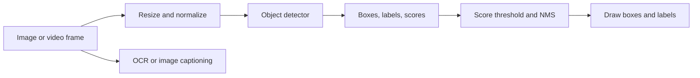

# Day 3 — Object Detection and AI Applications

The examples use Python's standard library and tiny sample data. Each topic has two exercises: Exercise 1 works through a question step by step; Exercise 2 demonstrates the concept with Python code and output. These examples teach the ideas and calculations; they do not run trained vision models. Try the change at the end to check your understanding.

## 1. Classification, detection, and segmentation

- **Classification:** assign a label to the whole image.
- **Object detection:** find objects and return a label and location for each.
- **Segmentation:** label the pixels belonging to each object or region.

### Exercise 1

A photo shows two cats. What should classification, object detection, and segmentation each return?

**Step-by-step solution:**

1. Classification describes the whole photo with one label: `cat`.
2. Detection finds each separate cat, so it returns two `cat` labels and one location box for each cat.
3. Segmentation labels the image pixels, marking which pixels belong to the cats and which are background.

### Exercise 2: compare the three kinds of output

These values are example predictions, not model inference.

```python
classification = "cat"
detections = [{"label": "cat", "box": (0, 0, 2, 2)}]
segmentation_mask = [[1, 1], [0, 1]]  # 1 = cat, 0 = background

print("classification:", classification)
print("detection:", detections[0])
print("segmentation mask:", segmentation_mask)
```

Output:

```text
classification: cat
detection: {'label': 'cat', 'box': (0, 0, 2, 2)}
segmentation mask: [[1, 1], [0, 1]]
```

Classification says what is in the image. Detection also says where. Segmentation marks the object pixel by pixel.

**Try:** Add a second detection with a different label and box.

## 2. Bounding boxes

- **Bounding box:** a rectangle marking an object's location in an image.
- **Coordinate format:** this note uses `(x_min, y_min, x_max, y_max)` for the left, top, right, and bottom edges.

### Exercise 1

For box `(3, 5, 11, 13)`, calculate its width, height, and center.

**Step-by-step solution:**

1. The box goes from `x=3` to `x=11`, so its width is `11 - 3 = 8`.
2. It goes from `y=5` to `y=13`, so its height is `13 - 5 = 8`.
3. The center's x-coordinate is halfway between the left and right edges: `(3 + 11) / 2 = 7`.
4. The center's y-coordinate is halfway between the top and bottom edges: `(5 + 13) / 2 = 9`.
5. The box center is **`(7, 9)`**, and its size is **8 by 8**.

### Exercise 2: calculate a box's size and center

```python
x_min, y_min, x_max, y_max = 10, 20, 50, 80
width = x_max - x_min
height = y_max - y_min
center_x = (x_min + x_max) / 2
center_y = (y_min + y_max) / 2

print("size:", width, "x", height)
print("center:", center_x, center_y)
```

Output:

```text
size: 40 x 60
center: 30.0 50.0
```

Always check whether a model returns pixel coordinates or normalized coordinates between `0` and `1`.

**Try:** Change `x_max` to `70`. What changes?

## 3. IoU: compare predicted boxes

**Intersection over Union (IoU):** a score measuring the overlap between a predicted box and the correct box.

Its formula is:

- `I`: the area shared by both boxes (intersection).
- `U = area(A) + area(B) - I`: the total area covered by either box (union). Subtract `I` so shared pixels are counted once.
- `IoU = I / U`: ranges from `0` (no overlap) to `1` (identical boxes).

### Exercise 1

Two 4×4 boxes overlap by 8 square units. Find their union area and IoU.

**Step-by-step solution:**

1. Each box is `4 × 4`, so each area is `16` square units.
2. Add the two areas, then subtract the shared overlap once: `union = 16 + 16 - 8 = 24` square units.
3. Divide the overlap by the union: `IoU = 8 / 24 = 1/3 ≈ 0.33`.
4. The boxes' IoU is **about 0.33**.

### Exercise 2: calculate IoU

```python
def area(box):
    x1, y1, x2, y2 = box
    return max(0, x2 - x1) * max(0, y2 - y1)

def iou(a, b):
    left, top = max(a[0], b[0]), max(a[1], b[1])
    right, bottom = min(a[2], b[2]), min(a[3], b[3])
    overlap = max(0, right - left) * max(0, bottom - top)
    union = area(a) + area(b) - overlap
    return overlap / union if union else 0

truth = (0, 0, 4, 4)
prediction = (2, 0, 6, 4)
print("IoU:", round(iou(truth, prediction), 2))
```

Output:

```text
IoU: 0.33
```

The boxes overlap by 8 square units; their combined covered area is 24. Evaluators use an IoU threshold to decide whether a detection matches.

**Try:** Change `prediction` to `(5, 5, 7, 7)`; the IoU becomes `0.0`.

## 4. Confidence filtering and NMS

- **Detection candidate:** a predicted box, class label, and **confidence score**.
- **Confidence score:** a ranking of how strongly the model supports a candidate; it does not guarantee correctness.

- **YOLO** (You Only Look Once): a family of object detectors that predicts boxes and classes in one model pass.

- **Non-maximum suppression (NMS):** removes lower-scoring boxes that overlap too much with a stronger box of the same class.

### Exercise 1

The score threshold is `0.5`. Two overlapping cat boxes score `0.92` and `0.80`; a dog box scores `0.35`. The cat-box IoU is `0.68`, and the NMS limit is `0.5`. Which boxes remain?

**Step-by-step solution:**

1. Apply the confidence threshold: the dog score `0.35` is below `0.5`, so remove the dog box.
2. Sort the remaining cat boxes by score. The `0.92` box is higher, so keep it first.
3. Compare the other cat box with the kept one. Their IoU is `0.68`, which is greater than the NMS limit `0.5`.
4. They overlap too much, so suppress the lower-scoring `0.80` box. Only the **`0.92` cat box** remains.

### Exercise 2: remove weak and duplicate detections

```python
def area(box):
    return max(0, box[2] - box[0]) * max(0, box[3] - box[1])

def iou(a, b):
    left, top = max(a[0], b[0]), max(a[1], b[1])
    right, bottom = min(a[2], b[2]), min(a[3], b[3])
    overlap = max(0, right - left) * max(0, bottom - top)
    union = area(a) + area(b) - overlap
    return overlap / union if union else 0

detections = [
    {"label": "cat", "score": 0.92, "box": (0, 0, 10, 10)},
    {"label": "cat", "score": 0.80, "box": (1, 1, 11, 11)},
    {"label": "dog", "score": 0.35, "box": (20, 20, 30, 30)},
]
score_limit = 0.5
iou_limit = 0.5
candidates = sorted(
    [item for item in detections if item["score"] >= score_limit],
    key=lambda item: item["score"],
    reverse=True,
)

kept = []
for candidate in candidates:
    duplicate = any(
        candidate["label"] == chosen["label"]
        and iou(candidate["box"], chosen["box"]) > iou_limit
        for chosen in kept
    )
    if not duplicate:
        kept.append(candidate)

print([(item["label"], item["score"]) for item in kept])
```

Output:

```text
[('cat', 0.92)]
```

The dog was below the score limit. The second cat box overlapped the first too much, so NMS removed it.

**Try:** Raise `iou_limit` to `0.8`. Does the second cat box remain?

## 5. OCR and multimodal AI

- **Multimodal AI:** AI that works with more than one kind of data, such as images and text.
- **Optical character recognition (OCR):** extracting text from an image.
- **Image captioning:** generating a text description of an image.

### Exercise 1

OCR returns `SHOP ABC`, `2026-10-20`, and `TOTAL 12.50`. Write the date and total amount.

**Step-by-step solution:**

1. Find the line formatted as a date: `2026-10-20`.
2. Find the line marked `TOTAL`: it says `TOTAL 12.50`.
3. The date is **`2026-10-20`** and the total amount is **`12.50`**.

### Exercise 2: inspect text returned by OCR

The string below represents OCR output; an OCR model would be needed to read a real image.

```python
ocr_text = "SHOP ABC\n2026-10-20\nTOTAL 12.50"
lines = ocr_text.splitlines()
date = next((line for line in lines if line.startswith("202")), None)
total = next((line for line in lines if "TOTAL" in line), None)

print("date:", date)
print("total:", total)
```

Output:

```text
date: 2026-10-20
total: TOTAL 12.50
```

Blur, handwriting, and small text can cause OCR errors. Check extracted values against the original image.

**Try:** Remove the total line and run the code again.

## 6. Latency and throughput

- **Latency:** the time required to produce one result.
- **Throughput:** the number of results produced per unit of time.

Image size, model size, preprocessing, and hardware affect both.

### Exercise 1

Three frames take `40 ms`, `50 ms`, and `60 ms`. Find the average latency and approximate frames per second.

**Step-by-step solution:**

1. Add the three frame times: `40 + 50 + 60 = 150` milliseconds.
2. Divide by 3 frames: average latency is `150 / 3 = 50 ms` per frame.
3. One second is `1000 ms`. At `50 ms` per frame, throughput is `1000 / 50 = 20` frames per second.

### Exercise 2: calculate average latency and throughput

Assume frames are processed one at a time.

```python
times_ms = [40, 50, 60]
average_ms = sum(times_ms) / len(times_ms)
frames_per_second = 1000 / average_ms

print("average latency:", average_ms, "ms")
print("throughput:", round(frames_per_second, 1), "frames/second")
```

Output:

```text
average latency: 50.0 ms
throughput: 20.0 frames/second
```

Measure the real application on its target hardware; toy timings do not predict production performance.

**Try:** Add `100` to `times_ms` and compare the average and throughput.

## 7. Test conditions and risks

- **Dataset bias:** a mismatch between the data used to build or evaluate a model and the conditions where it will be used.

Performance can vary with lighting, camera angle, or environment. Check who may be affected by missed detections or false alarms.

### Exercise 1

A model misses `0 of 2` cars by day and `2 of 2` at night. Calculate each miss rate.

**Step-by-step solution:**

1. Daytime miss rate is `missed cars / actual cars = 0 / 2 = 0`, or **0%**.
2. Nighttime miss rate is `2 / 2 = 1`.
3. Convert the fraction to a percentage: `1 × 100% = 100%`.
4. This small example gives a **0% day miss rate** and a **100% night miss rate**. Two examples per condition are not enough to prove real-world performance.

### Exercise 2: compare misses by lighting

```python
examples = [
    ("day", True, True),
    ("day", True, True),
    ("night", True, False),
    ("night", True, False),
]
counts = {}
for condition, actual_car, detected_car in examples:
    total, misses = counts.get(condition, (0, 0))
    counts[condition] = (
        total + int(actual_car),
        misses + int(actual_car and not detected_car),
    )

for condition, (total, misses) in sorted(counts.items()):
    print(condition, "misses:", misses, "of", total)
```

Output:

```text
day misses: 0 of 2
night misses: 2 of 2
```

This sample is too small to establish real performance. It shows why evaluation should cover the conditions where a system will be used. Images may also contain private information.

**Try:** Add one nighttime example the model detects correctly.

## Day 3: how a detection system works



## Day 3 recap

Classification labels an image; detection returns labels and boxes; segmentation labels pixels. IoU compares boxes. Confidence filtering and NMS remove weak or duplicate detections. OCR reads text from images. Measure speed and errors in realistic conditions, and review privacy and impact.
