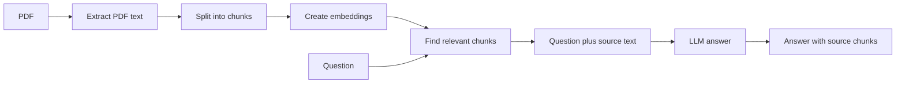

# Day 1 Project — Ask Questions About a PDF

Build a small command-line chatbot that finds relevant passages in a PDF and asks an LLM to answer using those passages. Follow the steps in order. You need Python 3.10 or newer, internet access to install packages and download the embedding model, and an OpenRouter API key for answer generation.

## What you are building



The embedding model and retrieval run locally. The selected passages and question are sent to OpenRouter for answer generation. Do not use private documents unless you are allowed to send their text to that service.

## Step 1 — Create the project environment

Open PowerShell in this folder and run:

```powershell
py -m venv .venv
.\.venv\Scripts\Activate.ps1
python -m pip install --upgrade pip
pip install -r requirements.txt
```

If `py` is unavailable, use `python` instead. If PowerShell blocks activation, run the app with `.venv\Scripts\python.exe app.py your_file.pdf`.

## Step 2 — Add your API key

Create an API key in your OpenRouter account. In the same PowerShell window, set it for this session:

```powershell
$env:OPENROUTER_API_KEY = "paste-your-key-here"
$env:OPENROUTER_MODEL = "openrouter/free"
```

Keep the key private. These commands do not save it in the project. You can select a different model available to your account by changing `OPENROUTER_MODEL`.

## Step 3 — Install and understand the libraries

`requirements.txt` installs:

- `pypdf` to extract text from PDF files.
- `sentence-transformers` to turn passages and questions into embeddings.

The first embedding-model run downloads model files and can take a while. The default model here is `all-MiniLM-L6-v2`.

## Step 4 — Read the application

Open `app.py`. Follow its functions in this order:

1. `extract_pdf_text` reads each page and joins its text. Scanned image-only PDFs need OCR and will not provide text here.
2. `make_chunks` splits the text into overlapping word groups. Overlap helps keep a thought from being cut at a boundary.
3. `embed_chunks` encodes each chunk once. The same model encodes the question.
4. `retrieve` ranks chunks by cosine similarity and returns the top matches.
5. `ask_model` sends the question and retrieved passages to the chat API. The instruction asks it to say when the passages do not contain an answer.
6. The main loop prints the answer and retrieved source chunks so you can check the grounding.

## Step 5 — Run it on a PDF

Put a text-based PDF in this folder, then run:

```powershell
python app.py "your_document.pdf"
```

Ask a question whose answer is clearly in the PDF. Then ask something unrelated. Review the printed source chunks: they should support the answer. Type `quit` to exit.

Example interaction (the answer varies by PDF and model):

```text
Question (or 'quit'): What is the return period?

Answer: The document says the return period is 30 days.

Retrieved passages:
[1] ...Items may be returned within 30 days of purchase...
```

## Step 6 — Learn by changing one thing

1. Change `chunk_size` in `main` from `120` to `60`. Ask the same question. Are passages too short to make sense?
2. Change `top_k` from `3` to `1`. Does the answer lose useful context?
3. Ask for something absent from the PDF. Does the model say it cannot find the answer? Compare its response with the retrieved passages.

Keep notes of each change and result. A better score or fluent answer does not by itself prove that the answer is correct.

## Troubleshooting

- **No text was found:** the PDF may be scanned. Use a text-based PDF or add OCR as a separate extension.
- **API key error:** set `OPENROUTER_API_KEY` in the current terminal and reopen the app.
- **Model error:** choose a model available to your OpenRouter account and set `OPENROUTER_MODEL`.
- **Slow first run:** downloading and starting the embedding model takes time; later runs are usually faster.
- **Wrong answer:** inspect the retrieved passages first. If they are wrong, improve chunking or retrieval. If they are relevant, the model may have misunderstood them.

## Project files

```text
day1project/
├── app.py
├── requirements.txt
└── README.md
```
